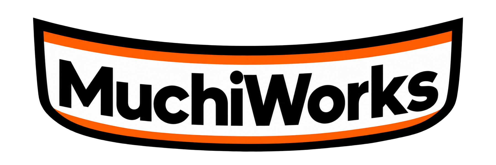
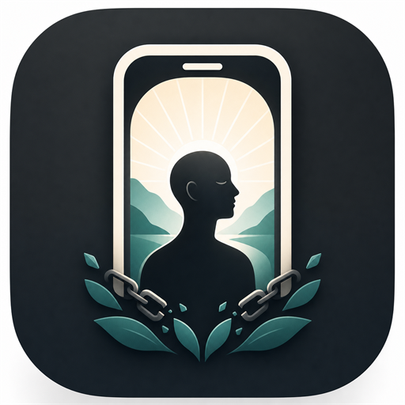

<table>
  <tr>
    <td width="220" align="center">
       
      
    </td>
    <td>
      <strong>About MuchiWorks</strong>  
      MuchiWorks is an independent software product studio focused on building
      clear, dependable digital products. It brings product decisions,
      application development, quality, and release work together under one
      roof.  
      Its current product is <strong>MuchiLife</strong>, an Android application
      designed to help people stay with the Focus boundaries they choose.
    </td>
  </tr>
</table>

<h1 align="center">Metin Çetin</h1>

  <strong>Founder and Software Engineer at MuchiWorks</strong> 
  Building useful mobile products from early product decisions through testing
  and release.

  <a href="https://muchiworks.com">MuchiWorks</a> ·
  <a href="https://muchiworks.com/products/muchilife">MuchiLife</a> ·
  <a href="https://github.com/MuchiWorks/muchilife-showcase">Engineering case study</a> ·
  <a href="mailto:developer@muchiworks.com">Contact</a> ·
  <a href="https://www.linkedin.com/in/cetinmetin/">LinkedIn</a>

## Currently building

<table>
  <tr>
    <td width="92" align="center">
      
    </td>
    <td>
      <strong>MuchiLife</strong> 
      An Android product that lets people choose a Focus duration, select the
      apps they want to keep closed, and stay with the boundary they set.
      Currently in Google Play closed testing.
    </td>
  </tr>
</table>

  

## What I own

| Area | Work |
| --- | --- |
| Product engineering | Product behavior, UX decisions, localization, accessibility, and release readiness |
| Android | React Native application, Android native integrations, API 24+ compatibility, phone and tablet behavior |
| Backend | Managed cloud services, data modeling, and dependable application workflows |
| Commerce | Google Play commerce integration and reliable transaction handling |
| Quality | Account safety, resilient behavior, testing, and operational visibility |
| Delivery | Environment separation, release validation, monitoring, and Play Console delivery |

## Selected engineering work

- Designed resilient mobile workflows that remain understandable when application
  or network conditions change.
- Built reliable commerce workflows with repeat-safe processing and clear outcomes.
- Developed account continuity across the sign-in methods supported by the product.
- Separated development and production delivery profiles with automated validation.
- Built release checks for localization, agreements, Android resources, and store metadata.

## How I work

I care about clear product behavior, recoverable operations, documentation that
matches the shipped product, and tests that cover failure paths rather than only
the happy path.

Most product source code is private and proprietary. Public case studies explain
the problems, constraints, decisions, and verification work without exposing
implementation details or customer data.

## Current focus

- Preparing MuchiLife through Google Play testing and production hardening
- Improving Android compatibility across OS versions and form factors
- Strengthening account, session, and commerce reliability
- Building MuchiWorks as a product studio for clear, useful software
